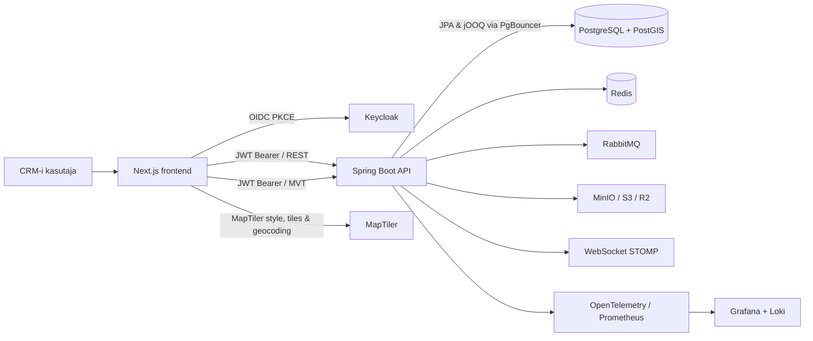

# ForestIQ 2.0 arhitektuur

> **Geospatial architecture authority — 2026-09-06:** Maa- ja Ruumiameti, katastri, ETAK-i, ruumiandmete ingestion'i, CRS-i, source-generation'i, tile-serving'u ja kaardialuskihtide puhul on [`docs/geospatial/ADR-001-target-geospatial-architecture.md`](geospatial/ADR-001-target-geospatial-architecture.md) ja [`docs/geospatial/ADR-002-crs-geometry-generation-contract.md`](geospatial/ADR-002-crs-geometry-generation-contract.md) autoriteetsemad kui selle dokumendi varasemad implementatsioonivalikud. Eelkõige ei ole Springi/modulaarse monoliidi säilitamine ega EPSG:4326 kanonilise MaRu geomeetria kasutamine enam kohustuslik sihtarhitektuuri piirang. Migratsioon on kirjeldatud failis [`docs/geospatial/cadastre-wfs-to-snapshot-migration.md`](geospatial/cadastre-wfs-to-snapshot-migration.md).

## Eesmärk

ForestIQ 2.0 asendab olemasoleva Angular 9, Spark Java ja käsitsi hallatava JDBC/Liquibase-lahenduse moodsa, selgelt eraldatud **Next.js 15 / Spring Boot 3 / PostgreSQL + PostGIS** monorepoga. Ümberkirjutus säilitab esmajärjekorras metsaomanike CRM-i, töölaudade, kinnistute ja kaartide kasutusjuhtumid ning eraldab vanad integratsioonid ja PDF-i eripärad adapterikihti.

> Juurutuse eesmärk ei ole teisendada vana lähtekoodi automaatselt. Uus süsteem kehtestab stabiilse API lepingu, organisatsioonipõhise autoriseerimise ning georuumilise andmemudeli, millele vana funktsionaalsus lisatakse järk-järgult.

## Monorepo struktuur

| Kataloog | Vastutus | Tehnoloogia |
| --- | --- | --- |
| `frontend/` | CRM-i kasutajaliides, kaart, tabelid, autentimise kasutajavoog | Next.js, React, TypeScript, Tailwind CSS, shadcn/ui, TanStack Query/Table, MapLibre GL JS |
| `backend/` | REST API, OIDC ressursiserver, domeeniloogika, sündmused ja integratsioonide adapterid | Java 21, Spring Boot 3, Spring MVC/Security, JPA/Hibernate, jOOQ |
| `backend/src/main/resources/db/migration/` | Versioonitud andmebaasimuudatused | Flyway, PostgreSQL, PostGIS |
| `infra/` | Kohalikud komponendid, mõõdikud, logid ning arendustaristu konfiguratsioon | Docker Compose, PgBouncer, Keycloak, Redis, RabbitMQ, MinIO, Prometheus, Grafana, Loki |
| `.github/workflows/` | Lintimine, testid, ehitamine ja konteinerpiltide kontroll | GitHub Actions |
| `docs/` | Arhitektuuri-, API- ja migratsioonidokumentatsioon | Markdown, OpenAPI |

## Kontekst ja suhtlusvood

## Funktsioonide migratsiooni piir

Olemasolevad kliendi marsruudid ja endpointide nimekiri annavad järgmise migratsioonijärjekorra. Esimene tarnitav vertikaallõige katab organisatsiooni kontekstis omanike otsingu, profiili, staatuse, kinnistud, geomeetria ja kasutajalogi. Need on süsteemi põhiandmed ning annavad kaardi ja CRM-i töölaudadele ühtse aluse.

| Valdkond | Olemasolev kasutus | 2.0 API / kasutajaliides | Seis |
| --- | --- | --- | --- |
| Autentimine ja kasutajad | Kohandatud JWT, TOTP, admin kasutajahaldus | Keycloak OIDC, JWT ressursiserver, `ORG_*` rollid; kasutajate haldus Keycloaki kaudu | Asendatud |
| Omanike CRM | Otsing, profiil, kommentaarid, staatus, jälgimine | `/api/v1/owners`, detail, staatus, timeline; TanStack Table ja detailvaade | Esimene vertikaallõige |
| Kinnistud ja kaart | Google Maps, markerid/polügoonid, sildid | PostGIS geomeetria, autentitud API MVT, MapLibre kaart, MapTiler geokodeerimine | Esimene vertikaallõige |
| Helistaja/evaluaatori/admini töölaud | Järjekorrad, määramised, massotsing | Eraldi töölaudade moodulid samale omaniku- ja kinnistu-API-le | Järgmine iteratsioon |
| Meeldetuletused ja sõnumid | Isiklikud meeldetuletused, WebSocket teated | Redis-cache, RabbitMQ sündmused, STOMP teavitused | Alus olemas |
| Lepingud ja dokumendid | PDF loomine ja allalaadimine | Dokumendi metaandmed PostgreSQL-is, objektid S3/R2-s, allkirjastatud URL-id | Adapteri iteratsioon |
| Välisregistrid ja impordid | Käsitsi Python-skriptid ja HTTP-päringud | Spring Batch / Quartz tööd ja RabbitMQ tööjärjekord | Adapteri iteratsioon |

## Autoriseerimismudel

Keycloak on identiteedipakkuja. API ei halda paroole ega väljastata oma tokeneid. Iga JWT sisaldab kasutaja identiteeti, aktiivset organisatsiooni ning rolle. Spring Security teisendab realm- ja kliendiroolid `ROLE_*` õigusteks ning nõuab organisatsiooni kontrolli teenusekihis. Kõik CRM-i read on seotud `organization_id` väärtusega; päringud saavad organisatsiooni vaid autentitud kontekstist, mitte kasutaja sisendist.

| Roll | Peamine õigus |
| --- | --- |
| `ORG_ADMIN` | Organisatsiooni seadistamine, massmääramised ja raportid |
| `CRM_MANAGER` | Kõigi oma organisatsiooni omanike, tööde ja staatuste haldamine |
| `EVALUATOR` | Organisatsiooni hindamisjärjekord, hinnanguandmed ja ownerite lugemine hindamise töövoos |
| `CALLER` | Ainult endale määratud omanike otsing, vaatamine ja tegevuslogi; assignment'i muuta ei tohi |
| `VIEWER` | Organisatsiooni piires ainult lugemise õigus |

Owner-taseme autoriseerimine on teenusekihi keskne policy: endpointi rollikontroll lubab ainult üldise toimingu tüübi, kuid konkreetse owneri lugemine või muutmine peab läbima assignment'i kontrolli. `CALLER` roll ei tohi üldiste `/api/v1/owners` endpointide kaudu näha ega muuta ownerit, mille `assigned_to_subject` ei ole tema JWT `sub` väärtus. Owner assignment'i muutmine on lubatud ainult `ORG_ADMIN` ja `CRM_MANAGER` rollidele.

## Andmete ja ruumiandmete disain

> **Geospatial target override:** allpool kirjeldatud EPSG:4326 `land_parcel.boundary` on olemasoleva rakenduse/compatibility kuju. Maa- ja Ruumiameti katastri, ETAK-i ja haldusandmete sihtleping on ADR-002 järgi kanoniline **EPSG:3301**, millest tuletatakse EPSG:3857 tile-geomeetria ja EPSG:4326 `[lon, lat]` browser/API koordinaadid.

PostGIS-is kasutatakse WGS84 (`geometry(..., 4326)`) geomeetriat. `land_parcel` hoiab katastriüksuse tunnust, pindala ja polügooni. Spatiaalsed indeksid tagavad kaardivaate ning piirkonnapäringute jõudluse. API väljastab MVT-kihid ainult autentitud organisatsiooni kontekstis; kasutajaliides ei saa tundlike päringute jaoks otsest andmebaasiühendust.

JPA haldab standardseid CRM-i agregaatide kirjutusi. jOOQ kasutab tüübiturvalisi, selgesõnalisi SQL-päringuid otsingu-, koond- ja PostGIS-funktsioonide jaoks. Flyway on ainus skeemimuudatuste allikas; JPA `ddl-auto` on igas keskkonnas `validate`.

## Backend teenusepiirid

Teenuseklassid on jaotatud kasutusjuhtumi järgi. Controller võtab vastu HTTP sisendi, service orkestreerib ärireegli ja transaction boundary, repository või adapter teeb välise I/O.

| Pakett | Vastutus |
| --- | --- |
| `ee.forestiq.owner` | Owner CRM-i otsing, detail, assignment, staatused, followings, activity ja parcel detailid eraldi repositoryde kaudu |
| `ee.forestiq.deal` | Tehingujuhtumi kvalifitseerimine, hindamise handoff, hindamisotsus ja läbirääkimiste algus; detaili- ja järjekorrapäringud on `DealQueryRepository` vastutus |
| `ee.forestiq.inheritance` | Pärimisjuhtumi business workflow; `InheritanceOfficialNoticeClient` omab ametliku pärimisteate HTTP adapterit |
| `ee.forestiq.registry` | Registriandmete värskuse ja sync orchestration; välisregistri HTTP suhtlus on adapterteenuses ning sync logi / data-signal kirjutused on audit repository vastutus |
| `ee.forestiq.ownership` | Weaseli omandiülemineku sync, data signal ja auditi import |
| `ee.forestiq.contract` | Lepingu konfiguratsiooni service koos eraldi company profile ja template repositorydega, PDF renderdus, contract history repository ja objektisalvestuse adapter |

## Kohalik käivitus ja konfiguratsioon

`docker compose up --build` käivitab täieliku arenduskeskkonna. Rakendused ootavad sõltuvuste tervisekontrolle ning loevad kõik keskkonnaspetsiifilised väärtused `.env` failist või standardsetest keskkonnamuutujatest. MinIO jäljendab arenduses S3 API-t; tootmises kasutatakse sama adapterit Cloudflare R2 või AWS S3 jaoks. MapTileri võti jääb ainult brauserisse lubatud avalikuks konfiguratsiooniks ning seda piiratakse MapTileri domeenireeglitega.

## Taustatööde käivitusgarantii

Praegune production guarantee on **single scheduler instance**: automaatsed `@Scheduled` registri-, pärimis-, Weaseli ja MetsIS värskendused võivad olla lubatud ainult ühes API protsessis või eraldi scheduler rollis. Mitme sama konfiguratsiooniga API replica puhul peavad automaatvärskenduste lipud jääma replika protsessides välja lülitatuks, sest rakendus ei kasuta veel JDBC Quartz job store'i ega hajuslukku. Kui background tööde käivitamine peab olema mitme replica vahel fault-tolerantne, tuleb enne selle lubamist lisada kas JDBC Quartz clustering või andmebaasipõhine distributed lock.

## Kvaliteediväravad

| Kiht | Kontroll |
| --- | --- |
| Frontend | TypeScripti kontroll, ESLint, komponentide testid ning Playwright E2E põhitöövoole |
| Backend | JUnit 5, Mockito, Spring MVC integratsioonitestid, RestAssured API testid ja Testcontainers PostgreSQL/PostGIS-iga |
| Andmebaas | Flyway valideerimine ning PostGIS-i migratsioonitest konteineris |
| Taristu | Docker Compose konfiguratsiooni kontroll ja tervisekontrollid |
| Vaatluspõhisus | Spring Actuator/Prometheus, OpenTelemetry korrelatsiooni-ID-d, struktureeritud JSON-logid Loki jaoks, Sentry DSN valikuline |

## Teadlikud piirid esimeses ümberkirjutuse etapis

Elasticsearch/OpenSearch jääb adapteriliidese taha ning PostgreSQL Full-Text Search on esmane otsingumootor. S3/R2 dokumentide salvestuse leping, RabbitMQ sündmuste topoloogia, WebSocketi teema ja Spring Batchi tööde põhistruktuur luuakse kohe, kuid vanade registri-importide, PDF-mallide ja kõigi töölaudade detailne teisaldus vajab nende välisteenuste ligipääse ja ärireeglite kinnitamist. Nii jääb süsteem käivitatavaks ning laiendatavaks ilma vanade, aegunud sõltuvuste ülekandmiseta.
