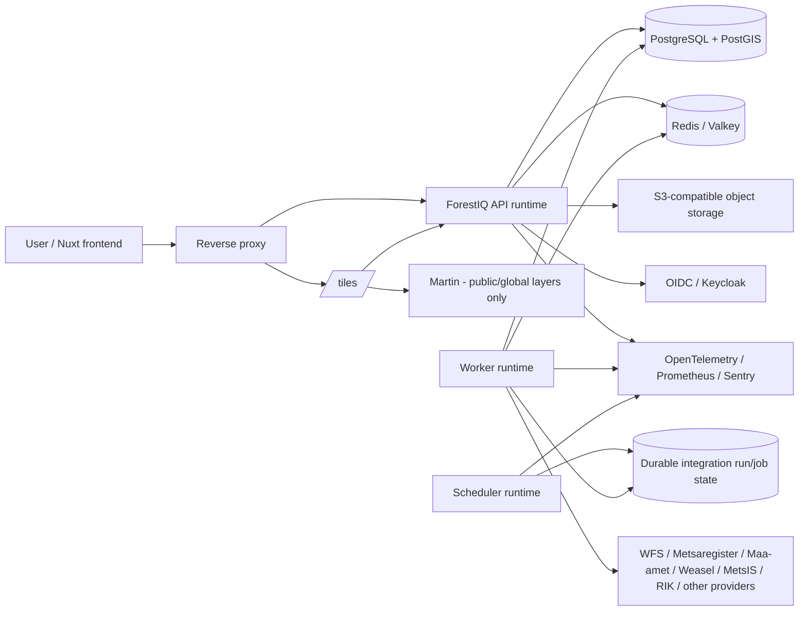

# ForestIQ backend target architecture

**Status:** target architecture / implementation roadmap  
**Date:** 2026-08-26  
**Scope:** ForestIQ backend, spatial data, integrations, runtime topology and backend-facing API contracts

## 1. Eesmärk

ForestIQ backend peab jääma kiireks ja töökindlaks ka siis, kui süsteemis on miljoneid ruumiandmete ridu, mitu samaaegset registri-importi, mitu organisatsiooni ning kasutajad töötavad samaaegselt CRM-i, kaartide, tehingute ja administratsioonivaadetega.

Sihtarhitektuur ei ole mikroteenuste ümberkirjutus. ForestIQ jääb **modulaarseks monoliidiks**, mida saab käivitada eri runtime-rollides (`api`, `worker`, vajadusel `scheduler`). Sama koodibaas jagab domeeniloogikat, andmemudelit, migratsioone ja integratsiooniadaptereid, kuid latency-sensitive HTTP liiklus eraldatakse pikkadest taustatöödest.

Peamised eesmärgid:

- tavaline API vastus peab olema kiire ja prognoositav;
- kaart ei tohi brauserisse laadida suuri GeoJSON/WFS kihte;
- PostGIS peab skaleeruma mitme miljoni geomeetriani;
- integratsioonid peavad olema chunked, resumable, idempotent ja crash-safe;
- organisatsioonide andmed ei tohi lekkida REST-i, cache'i, tile'i ega job'i kaudu;
- andmekiht peab kasutama keerukate päringute jaoks selgesõnalist SQL-i/jOOQ-d;
- infrastruktuuri saab hiljem skaleerida API ja workerite arvu eraldi suurendades;
- süsteemi jõudlus peab olema mõõdetav, mitte oletuslik.

## 2. Praegune baas ja evolutsioon

ForestIQ kasutab juba head alust: Java 21, Spring Boot 3.5, Spring Security/OIDC, jOOQ, JPA, Flyway, PostgreSQL/PostGIS, Redis, AMQP, Actuator, Prometheus/OpenTelemetry, Sentry ja S3 adapter.

Sihtarhitektuur kasutab seda olemasolevat tööd ning liigub järgmise mudeli poole:

| Valdkond | Praegu | Siht |
| --- | --- | --- |
| Java | Java 21 | Java 25 LTS |
| Spring | Spring Boot 3.5.x | Spring Boot 4.x pärast compatibility spike'i |
| Backend kuju | monoliit | enforce'itud modulaarne monoliit |
| Read data access | JPA + jOOQ | jOOQ-first read/spatial/reporting, JPA valitud write agregaatidel |
| GIS frontend data | REST/MVT segu | vector-tile-first suurtele kaartidele |
| Protected tiles | API | Spring + jOOQ + PostGIS MVT |
| Public/global tiles | API või väline | Martin lubatud ainult mitte-tundlikele kihtidele |
| Integratsioonid | scheduler + integration executor | durable job model + eraldi worker runtime |
| Cache | Redis | dokumenteeritud bounded cache policy; PostgreSQL jääb source of truth |
| API contract | Springdoc/OpenAPI | OpenAPI + genereeritud TypeScript client |
| Performance | metrics/testid | mõõdetud p95/p99 budgetid + load/spatial benchmarkid |

**Oluline:** Java/Spring versiooniuuendus ei pea blokeerima PostGIS/MVT, jOOQ ega worker-runtime tööd. Arhitektuuri parandused võib teha järk-järgult praegusel 3.5/21 baasil ja runtime'i uuendada eraldi kontrollitud muudatusena.

## 3. Kõrgtaseme arhitektuur



Kõik ForestIQ kasutajaliidese endpointid võivad olla ühe domeeni taga:

```text
/             frontend
/api/*        Spring API
/tiles/*      protected/public vector tiles
/auth/*       OIDC flow / reverse-proxy routes as needed
```

See vähendab CORS-i, cookie/headeri ja redirect-konfiguratsiooni keerukust.

## 4. Modular monolith

Backend jagatakse bounded-context tüüpi mooduliteks. Moodulipiir peab olema koodis enforce'itud, mitte ainult dokumentatsioonis.

Soovituslikud top-level moodulid:

```text
ee.forestiq
  shared
  security
  organization
  owner
  property
  gis
  deal
  inheritance
  contract
  document
  messaging
  integration
    registry
    metsis
    ownership
    inheritancefeed
  admin
```

Iga mooduli sisemine kuju:

```text
<module>/
  web/              controller + request/response mapping
  application/      use cases, orchestration, transaction boundary
  domain/           policies, domain rules, value objects
  port/             repository/provider interfaces where useful
  infrastructure/   jOOQ/JPA repositories, HTTP clients, S3, cache adapters
```

Lubatud sõltuvussuund:

```text
web -> application -> domain -> port <- infrastructure
```

Cross-module suhtlus peab toimuma application-facing interface'i, event'i või spetsiaalse read model'i kaudu. Ühe mooduli service ei tohiks minna teise mooduli sisemisse repositorysse.

`shared` ei tohi muutuda üldiseks dumping-ground'iks. Sinna sobivad ainult näiteks:

- authenticated request context;
- pagination primitives;
- common error model;
- clock/time abstraction;
- identifiers;
- correlation/observability helpers.

ArchUnit või samaväärsed testid peavad keelama valed package dependency'd CI-s.

## 5. HTTP/API kiht

Controller peab tegema ainult:

1. HTTP input mapping;
2. bean validation;
3. autoriseerimise üldtaseme kontrolli;
4. application service'i väljakutse;
5. DTO vastuse koostamise.

Controller ei tee:

- SQL-i;
- provider HTTP päringuid;
- pikaajalist taustatööd;
- business transaction orchestration'it.

REST jääb ForestIQ põhilepinguks. GraphQL-i ei ole vaja.

Põhireeglid:

- API base: `/api/v1`;
- OpenAPI on frontend-backend lepingu masinloetav allikas;
- frontendile genereeritakse TypeScript client/types;
- persistence entity ei ole API DTO;
- pageable endpointid kasutavad üht bounded pagination/filter/sort lepingut;
- vead kasutavad üht error envelope'i: `code`, `message`, `correlationId`, vajadusel `fieldErrors`;
- pika integratsiooni käivitamine tagastab kohe durable `runId/jobId`, mitte ei hoia request'i lahti.

Näide:

```http
POST /api/v1/integrations/metsaregister/runs
202 Accepted

{
  "runId": "...",
  "status": "QUEUED"
}
```

Seisu saab küsida:

```http
GET /api/v1/integration-runs/{runId}
```

## 6. Data access: jOOQ-first read architecture

ForestIQ puhul on suur osa väärtuslikest päringutest SQL-heavy: PostGIS, owner/property otsing, filtering, dashboard aggregation, stale queues, reporting ja vector tiles.

Seetõttu on sihtreegel:

### jOOQ

Kasuta vaikimisi:

- PostGIS päringud;
- spatial intersection/bbox/distance;
- MVT;
- search/filter/sort/paging;
- dashboard ja reporting;
- cross-module read model'id;
- batch update/upsert;
- suure mahuga list endpointid.

### JPA

Kasuta ainult seal, kus bounded transactional aggregate write on ORM-iga lihtsam ja mõõdetavalt probleemivaba.

API response ei tohi sõltuda lazy entity graph'ist. Read endpoint peab küsima DB-st täpselt selle projection'i, mida UI vajab.

Näide:

```text
OwnerController
  -> OwnerQueryService
      -> OwnerQueryRepository (jOOQ)
          -> PostgreSQL
```

mitte:

```text
Controller -> JPA entity -> lazy relations -> serializer
```

Kõik organization-owned query'd peavad saama `organizationId` authenticated context'ist ja lisama scope'i SQL-i enne pagingut.

## 7. PostgreSQL/PostGIS andmemudel

PostgreSQL on äriseisu source of truth. Redis, S3 ja tile cache ei tohi asendada business truth'i.

Põhimõtted:

- Flyway on ainus schema migration source;
- jOOQ generated schema peab vastama Flyway skeemile;
- GIS query'd kasutavad sobivaid GiST indekseid;
- organization/cadastral/source/status/cursor väljade jaoks kasutatakse query-pattern põhiseid composite B-tree indekseid;
- suuri registry/history/raw tabeleid partitionitakse ainult mõõdetud vajaduse alusel;
- current state ja high-volume raw/history tuleb vajadusel eraldada;
- geomeetria normaliseerimine/validity tehakse ingestion/apply etapis, mitte igal request'il uuesti;
- dense/low-zoom tile'ide jaoks võib lisada simplified geometry/read model'i, kui benchmark seda õigustab.

Olulised päringud peavad olema kontrollitud `EXPLAIN (ANALYZE, BUFFERS)` abil realistliku andmemahu juures.

## 8. Vector tile architecture

Kaardi põhireegel: **brauserisse ei saadeta tervet suurt registrikihti GeoJSON-ina**.

Protected organization layer:

```text
MapLibre
  -> GET /tiles/organization-parcels/{z}/{x}/{y}.mvt
      -> Spring Security
      -> organization/resource policy
      -> jOOQ
      -> PostGIS ST_TileEnvelope + bbox filter
      -> ST_AsMVTGeom
      -> ST_AsMVT
```

SQL kuju on kontseptuaalselt:

```sql
WITH bounds AS (
    SELECT ST_TileEnvelope(:z, :x, :y) AS geom
), features AS (
    SELECT
        p.id,
        p.cadastral_code,
        ST_AsMVTGeom(p.geom, bounds.geom) AS geom
    FROM land_parcel p, bounds
    WHERE p.organization_id = :organizationId
      AND p.geom && bounds.geom
)
SELECT ST_AsMVT(features.*, 'parcels')
FROM features;
```

Reaalses implementatsioonis tuleb arvestada SRID/projection'i, clip'i, extent'i, simplification'i ja null-geomeetria detailidega.

### Martin

Martin sobib public/global kihtidele, kus ForestIQ kasutaja/organisatsiooni autoriseerimist pole vaja. Martin ei tohi saada otseteeks protected owner/parcel/workflow andmetele.

Kui kiht vajab ForestIQ authorization policy't, genereeritakse see API kaudu või kasutatakse eraldi turvalist tile-proxy/policy mehhanismi, mille correctness on testitud.

## 9. Background jobs ja integratsioonid

API request ei tohi teha mitme minuti pikkust WFS/import tööd.

Sihtmudel:

```text
API/admin action or scheduler
  -> create durable integration run
  -> QUEUED

Worker
  -> claim run
  -> RUNNING
  -> fetch page/chunk outside main apply transaction
  -> validate
  -> short transactional apply/upsert
  -> persist checkpoint/metrics
  -> next page/chunk
  -> SUCCEEDED / FAILED / PARTIAL
```

Job'i invariandid:

- durable run state;
- idempotent apply;
- resumable checkpoint;
- bounded page/chunk size;
- bounded retries + exponential backoff/jitter;
- provider concurrency/rate-limit control;
- failure ei liiguta cursorit üle tõendamata andmete;
- partial snapshot ei tohi asendada last-known-good state'i;
- network fetch ei hoia business apply transaction'it lahti;
- crash/orphan recovery;
- manual ja scheduled run kasutavad sama execution engine'it.

Selle valdkonna reliability detailid on juba kaetud continuous-ingestion epicus #69 ning issue'des #59-#68. Uus backend architecture peab neid lahendusi reuse'ima, mitte looma paralleelset job framework'i.

## 10. Runtime roles

Sama artefakti saab käivitada erineva rolliga.

### `api`

- REST;
- protected MVT;
- auth;
- interactive business use cases;
- ei tee heavy scheduled integration execution'it.

### `worker`

- integration jobs;
- imports;
- heavy exports/maintenance;
- configurable concurrency;
- võib skaleeruda API-st sõltumatult.

### `scheduler`

- määrab, milline feed/job on due;
- loob durable job/run'i;
- ei tee ise pikka provider tööd.

Väiksemas deployment'is võivad `worker` ja `scheduler` olla samas protsessis, kuid vastutus peab koodis jääma lahutatuks.

## 11. Cache

Redis/Valkey on optimization layer, mitte source of truth.

Sobivad cache'i kandidaadid:

- dashboard summary;
- reference/lookup metadata;
- bounded short-lived expensive query results;
- safe public tile/read model;
- vajadusel lühikese TTL-iga protected result, kui cache key sisaldab täielikku org/user/policy scope'i.

Ei cache'ita pimesi:

- authorization decision'e pikkadeks perioodideks;
- huge raw WFS payload'e;
- business state'i viisil, mis muudab Redis'e nõutavaks correctness'i jaoks.

Protected cache key peab sisaldama vähemalt organization scope'i ja kõiki query contract'i mõjutavaid parameetreid.

Cache'i rike peaks võimalusel degrade'uma PostgreSQL/API peale, mitte võtma kogu rakendust maha.

## 12. Organisatsioonieraldus ja security invariant

`organizationId` tuleb authenticated context'ist. Tavakasutaja API ei saa valida teist organisatsiooni request parameter/body väärtusega.

Sama invariant kehtib:

- jOOQ query;
- JPA mutation;
- cache key;
- vector tile SQL;
- object metadata;
- background job context;
- integration checkpoint/run;
- audit event.

Protected query puhul peab organization filter rakenduma enne pagingut/aggregation'i/MVT encoding'ut.

System-wide admin operation on eraldi privileged path ja peab olema auditeeritav.

Kõige olulisem security regression test on kahe organisatsiooni test: org A identiteediga ei tohi olla võimalik saada org B ownerit, kinnistut, tehingut, dokumenti, tile feature'it, cache result'i ega job state'i.

## 13. Object storage

S3-compatible storage sobib PDF-idele ja suurtele immutable failidele.

PostgreSQL hoiab vähemalt:

- ownership/organization metadata;
- object key;
- content type;
- size/hash;
- creation/audit metadata;
- business relation.

Objektisalvestuse outage ei tohi korrumpeerida business transaction'it. Kui ForestIQ säilitab DB fallback copy't, peab fallback policy olema teadlikult defineeritud (vt ka issue #50).

## 14. Observability

Iga request/job peab olema seostatav correlation/trace ID-ga.

Mõõdikud vähemalt:

### API
- request count;
- p50/p95/p99 latency;
- error rate;
- response size;
- auth failures.

### Database
- pool usage;
- query duration;
- slow-query count;
- transaction duration;
- key query plan/performance regression.

### Tiles
- tile latency;
- tile bytes;
- feature count;
- cache hit/miss;
- dense tile warnings.

### Jobs
- queue depth;
- active runs;
- run duration;
- rows/pages processed;
- retries/failures;
- cursor/backlog lag;
- data freshness SLO.

Data freshness monitoring on seotud issue'ga #67.

## 15. Performance budgetid

Esialgsed targetid, mida tuleb realistliku andmemahuga mõõta ja vajadusel korrigeerida:

| Operatsioon | Target |
| --- | ---: |
| common API read p95 | < 200 ms |
| complex search/filter p95 | < 300 ms |
| backend detail query p95 | < 300 ms |
| cached vector tile p95 | < 100 ms |
| job enqueue | < 250 ms |
| background provider work HTTP request threadil | 0 |

Frontend UX target ei tähenda, et iga DB query peab olema <100 ms; oluline on end-to-end budget ja mõõdetud bottle-neck.

## 16. Testing strategy

### Unit
- domain policy;
- mapper/validation;
- cursor/idempotency algorithms.

### Repository integration
- Testcontainers PostgreSQL/PostGIS;
- päris Flyway schema;
- jOOQ query correctness;
- spatial functions/index-sensitive scenarios.

### API integration
- Spring Security + kahe organisatsiooni isolation;
- pagination/error contract;
- mutation transaction behavior.

### Job tests
- retry;
- crash/resume;
- page cap;
- partial snapshot;
- duplicate overlap;
- provider timeout/5xx/malformed payload;
- worker saturation.

### Performance
- owner/property search;
- detail;
- dashboard;
- dense/sparse MVT tile;
- API under concurrent background ingestion.

H2 ei tohi olla PostGIS correctness testide asendaja.

## 17. Deployment model

Esimene production-grade mudel ei vaja Kubernetes't.

Piisav topology:

```text
reverse proxy
  -> frontend
  -> 1..N api instances
  -> optional Martin

1 scheduler
1..N workers

managed/durable PostgreSQL + PostGIS
Redis/Valkey
S3-compatible storage
OIDC provider
observability stack
```

API ja worker võivad alguses olla üks replica kumbki. Oluline on, et süsteem võimaldab neid hiljem sõltumatult skaleerida.

## 18. Teadlikud non-goals

Praeguses etapis ei ole vaja:

- Kubernetes't;
- business-domain mikroteenuseid;
- GraphQL-i;
- MongoDB-d;
- Elasticsearch/OpenSearchi enne mõõdetud PostgreSQL search piirangut;
- GeoJSON full-layer download'i kui kaardi vaikimisi transporti;
- Go/Rust rewrite'i ainult performance lootuses.

## 19. Migratsioonijärjekord

Soovituslik järjekord:

1. **P0 architecture boundaries** — #77
2. **P0 jOOQ-first read model** — #79
3. **P0 protected vector tiles** — #80
4. **P0 PostGIS scale/indexing** — #81
5. **P0 API/worker runtime separation** — #82, koos existing epic #69-ga
6. **P0 organization isolation invariant** — #86
7. **P1 API/OpenAPI generated client** — #83
8. **P1 caching policy** — #84
9. **P1 performance benchmark/budgets** — #85
10. **P1 Java 25 / Spring Boot 4 runtime upgrade** — #78, kui compatibility spike on roheline

Runtime versiooniuuenduse võib ajastada varem või hiljem, kuid seda ei tohiks kombineerida üheks suureks PR-iks PostGIS/MVT/domain refactoriga.

## 20. Definition of Done

Backend target architecture võib lugeda rakendatuks, kui:

- moodulipiirid on koodis ja CI-s enforce'itud;
- kriitilised read/spatial query'd on jOOQ-põhised ja mõõdetud;
- suured kaardikihid liiguvad vector tile'idena;
- protected tile ei saa mööda organization authorization'ist;
- PostGIS indeksid/query plan'id on realistliku mahu juures kontrollitud;
- API ja background worker workload on runtime'is eraldatav;
- integratsioonid on durable/resumable/idempotent vastavalt epic #69 nõuetele;
- OpenAPI contract genereerib frontendile TypeScript client'i;
- cache policy on bounded ja organization-safe;
- p95/p99 performance ning job/data freshness on observable;
- cross-organization negative testid katavad kriitilised moodulid;
- production deployment ei sõltu sleeping/free runtime'ist ega ühe HTTP protsessi schedulerist.
