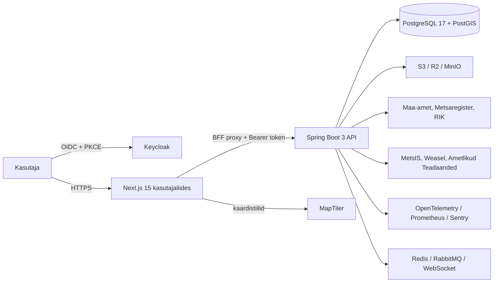
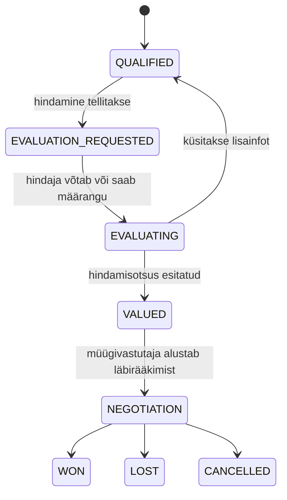

# ForestIQ tehniline spetsifikatsioon

**Dokumendi versioon:** 1.0  
**Rakenduse alus:** ForestIQ 2.0, `main` haru  
**Sihtlugeja:** arhitekt, arendaja, DevOps-insener, turbevastutaja ja tehniline teenuseomanik  
**Autor:** Manus AI

## 1. Eesmärk ja süsteemi piir

ForestIQ on multi-tenant metsaomanike CRM ja georuumiline töölaud. Süsteem haldab organisatsioonipõhiseid omanikke, kinnistuid, müügiprotsessi, hindamisotsuseid, lepinguid, pärimisjuhtumeid, teavitusi ja välisandmete sünkroonimist. Rakendus on monorepo, mille klient, API, skeemimuudatused, taristu kirjeldused, automatiseeritud testid ja käitusdokumentatsioon asuvad samas versioonihaldusüksuses.[1]

Süsteem ei ole üldotstarbeline avalik andmekogu. Kõik ärilised ja isikuandmeid sisaldavad ressursid on seotud `organization_id` väärtusega ning organisatsiooni piir tuletatakse autentitud kasutaja JWT-st. Kasutaja sisend ei tohi valida teist organisatsiooni.[1]



## 2. Tehnoloogiapinu

| Kiht | Tehnoloogia | Vastutus |
| --- | --- | --- |
| Veebiklient | Next.js 15, React, TypeScript | Vaated, OIDC sessioon, sama päritoluga API-proxy, vormid ja töölaudade kasutuskogemus. |
| Kasutajaliidese komponendid | Tailwind CSS, shadcn/ui, TanStack Query ja Table | Responsiivne kujundus, serveriandmete vahemälu ja tabelid. |
| Kaart | MapLibre GL JS, MapTiler | Kinnistute ruumiline töölaud, aluskaart ja stiil. |
| API | Java 21, Spring Boot 3, Spring MVC, Spring Security | REST API, autoriseerimine, ärireeglid, integraatorid ja terviseproovid. |
| Andmepääs | JPA/Hibernate ja jOOQ | Standardsete agregaatide haldus ning täpne SQL/PostGIS lugemis- ja koondpäringute teostus. |
| Andmebaas | PostgreSQL 17, PostGIS 3.5, Flyway | Tehinguline CRM, geomeetria, täistekstiotsing, versioonitud skeem. |
| Identiteet | Keycloak, OIDC, OAuth 2.0 | Kasutajate sisselogimine, JWT, rollid ja organisatsiooniväide. |
| Dokumendid | S3-ühilduv objektisalvestus | Lepingute PDF-objektid; PostgreSQL hoiab metaandmeid ja dokumendiajalugu. |
| Asünkroonne töö | Spring `@Scheduled`, advisory lock, WebSocket/STOMP; valikuline Redis ja RabbitMQ | Tausttööd, integratsioonide käivitamine, reaalajas olekusündmused. |
| Vaatluspõhisus | Actuator, OpenTelemetry, Prometheus, Grafana, Loki, Sentry | Tervis, mõõdikud, logid, trace'id ja erandite edastus. |

Rakenduse tehnoloogiline siht ja põhikomponendid on kirjeldatud lähtearhitektuuris ning README-s.[1] [2]

## 3. Monorepo struktuur

| Asukoht | Sisu | Omanik või kasutaja |
| --- | --- | --- |
| `frontend/` | Next.js rakendus, BFF-marsruudid, OIDC-sessioon ja Playwright/Vitest testid | Frontend-arendus. |
| `backend/` | Spring Boot API, domeeniteenused, jOOQ, JPA, Flyway ja JUnit testid | Backend-arendus. |
| `backend/src/main/resources/db/migration/` | Flyway SQL-migratsioonid ja korduvad puhastusmigratsioonid | Andmebaasi omanik. |
| `infra/` | Observability ja Keycloaki taristukonfiguratsioon | DevOps. |
| `scripts/` | Andmeimport, arenduse seemned, E2E seemned ning tootmise preflight | Tehniline teenuseomanik. |
| `docs/` | Äri-, töövoo-, arhitektuuri- ja käitusdokumendid | Kõik meeskonnad. |
| `.github/workflows/` | CI, E2E ja konteineriturbe kontrollid | DevOps / kvaliteediomanik. |

## 4. Loogiline arhitektuur ja teenusepiirid

ForestIQ kasutab kasutusjuhtumikeskset teenusejaotust. Controller valideerib HTTP sisendi ja rakendab üldise rollipiiri. Rakendusteenus on ärireegli ning transaktsiooni omanik. Repository või välisadapter teostab andmebaasi- või võrgusuhtluse. Controller ei ava ärilisi transaktsioone ning väline adapter ei kirjuta CRM-i töövoo otsuseid.[3]

| Moodul | Rakendusteenuse vastutus | Püsivuse / adapteri vastutus |
| --- | --- | --- |
| `owner` | Omaniku CRM, olekud, määrangud, tegevused, jälgimised, import | Otsing, profiil, kinnistuseosed ja importide audit. |
| `deal` | Kvalifitseerimine, hindamine, pakkumine, läbirääkimine ning samaaegsuse reeglid | Tehingu lugemis- ja käsupäringud, lukud, hindamisversioonid, meeldetuletused ja sündmused. |
| `inheritance` | Juhtumi, pärijate, staatuste ja ametliku teate sobitamise töövoog | Ametliku teate HTTP klient ning juhtumi/ajaloosündmuste repository. |
| `registry` | Värskusreegel, pakkujate järjestus, tõrgete isoleerimine ja andmesignaalide otsus | WFS/SOAP protokoll, katastri- ja metsaregistri hetktõmmised ning sünkrooniaudit. |
| `ownership` | Weaseli omandiüleminekute sünkroonimise äriline orkestreerimine | Provideri sündmuste adapter ja muutuse audit. |
| `portfolio` | MetsIS/Forestek omaniku–katastri seoste hetktõmmise rakendamine | Portfelli HTTP klient ning kinnistuseoste püsivus. |
| `contract` | Ettevõtteprofiilid, mallid, lepingu tuletamine ja PDF töövoog | HTML→PDF renderdus, S3 adapter, dokumentide ajalugu. |
| `messaging`, `reminder`, `sales`, `phonebook` | Sisekommunikatsioon, järeltegevused ja tööjärjekorrad | Organisatsiooniga piiratud lugemis- ja kirjutuspäringud. |

Tehingu, pärimise ja registri üksikasjalikud teenusepiirid ning transaktsioonireegel on dokumenteeritud backend-service-boundaries kirjelduses.[3]

## 5. Identiteet, sessioon ja autoriseerimine

### 5.1 Autentimine

Keycloak on ForestIQ identiteedipakkuja. Klient algatab OIDC Authorization Code + PKCE voo, kontrollib `state` väärtust ning hoiab juurdepääsu- ja refresh-tokenit serveripoolsete HttpOnly küpsiste abil. Next.js BFF-proxy lahendab sessiooni, lisab API-kutsele Bearer-tokeni ja ei anna refresh-tokenit brauseri JavaScriptile.[4]

API käitub OAuth2 ressursiserverina. JWT sisaldab vähemalt kasutaja `sub` ning aktiivse `organization_id` väidet; Spring Security teisendab Keycloaki realm- ja kliendiroolid `ROLE_*` õigusteks. API ei halda paroole ega väljasta rakendusesiseseid JWT-sid.[1]

### 5.2 Õiguste rakendamine

| Turbetase | Rakendusviis |
| --- | --- |
| Transpordikiht | Tootmises HTTPS, HSTS ja pöördpuhverserveri TLS lõpetus. |
| Veebiklient | CSP, `X-Frame-Options: DENY`, `X-Content-Type-Options: nosniff`, piiratud permissions-policy ja referrer-policy.[5] |
| API marsruut | `@PreAuthorize` rollikontroll HTTP toimingu tasemel. |
| Ressursitase | `OwnerAuthorizationService` ning teenusekihi määrangukontroll omanikust tuletatud ressursside puhul.[6] |
| Tenant-piir | Päringud võtavad `organization_id` autentitud kontekstist, mitte body/query sisendist.[1] |
| Andmebaas | Organisatsiooniveerud, FK-d, unikaalsusreeglid ja Flyway skeemikontroll. |

`CALLER` on alati määrangupiiriga roll. Ka siis, kui token sisaldab lisaks `VIEWER` või `EVALUATOR`, ei laiene selle kasutaja omaniku- ja kinnisturesursside nähtavus üle oma määrangu. See reegel kehtib ka kaardikihile, katastriandmetele ja tehinguandmetele.[6]

## 6. Andmemudel

### 6.1 Põhiagregaadid

| Agregaat | Olulised mõisted | Seosed |
| --- | --- | --- |
| Organisatsioon | `organization` | Kõigi äriandmete tenant-juur. |
| Omanik | `owner` | Kontakt, staatus, vastutaja, tegevused ja kinnistuseosed. |
| Kinnistu | `land_parcel` | Katastritunnus, pindala, WGS84 geomeetria, aktiivsed omaniku seosed. |
| Omaniku–kinnistu seos | `owner_parcel_relation` | Paljud-mitmele omandisuhe, elutsükkel ja kanoniline aktiivse omandi alus. |
| Tehingujuhtum | `deal_case`, `deal_case_parcel`, `deal_evaluation`, `deal_case_event` | Omanik, hinnatavad kinnistud, etapp, hindamisversioonid, pakkumised ja audit. |
| Meeldetuletus ja tegevus | `reminder`, `owner_activity`, followings | Isiklik tööjärjekord ning CRM-i ajalugu. |
| Leping | ettevõtteprofiil, mall, lepingukirje, PDF-objekt | HTML-mall, tuletatud andmed, dokumendi ajalugu ja objektisalvestus. |
| Pärimisjuhtum | juhtum, pärijad, sündmused | Omanik, ametlik teade, kontaktitöö ja lõpetamise ajalugu. |
| Integratsioon | jooks, sünkroonlogi, andmesignaal, checkpoint | Andmeallika käik, tulemus, mõõdikud ja idempotentsus. |

Kinnistute geomeetria on WGS84 (`EPSG:4326`) PostGIS geomeetria. Flyway on skeemimuutuste ainus allikas ning Hibernate töötab `validate` režiimis; rakendus ei tohi skeemi automaatselt muuta.[1]

### 6.2 Andmete terviklus

Tehingu etapi üleminek kasutab expected-state tingimust. Kui vahepeal muudab sama juhtumit teine kasutaja või protsess, tagastab API HTTP 409 ning muudatuste transaktsioon pööratakse tagasi. Hindamise revisioni kaitseb ka andmebaasi unikaalsusreegel `(deal_case_id, revision)`.[7]

Omanike impordi puhul kontrollitakse fail, veeruseos ja SHA-256 nii preview kui commit etapis. Andmebaasi unikaalsusreegel `(organization_id, personal_or_registry_code)` on viimane kaitse samaaegse topeltlisamise vastu.[8]

## 7. REST API ja kliendimarsruudid

API avalik OpenAPI kirjeldus on vaikimisi aadressil `/api/openapi` ning Swagger UI aadressil `/api/swagger-ui.html`. Kliendipoolne API-proxy elab marsruudil `/api/[...path]` ning saadab päringud autentitud sessiooni alusel backendile.[2]

| API ala | Peamised marsruudid ja kasutus |
| --- | --- |
| Omanikud | `/api/v1/owners`: otsing, detail, loomine, muutmine, olek, tegevused, followings ja import. |
| Kinnistud ja kaart | Katastri detail-/värskendusmarsruudid ning autentitud MVT kaardikihid. |
| Tehingud | `/api/v1/deals`: omaniku brief, tehingu loomine, hindamisjärjekord, hindaja määrang, hindamisotsus ja läbirääkimine. |
| Lepingud | `/api/v1/contracts` ja haldusmarsruudid: mallid, ettevõtted, PDF loomine ning turvaline allalaadimine. |
| Pärimine | `/api/v1/inheritance`: tööruum, juhtumite otsing, määrangud, ametlike teadete kontroll, pärijad ja sündmused. |
| Integratsioonid | `/api/v1/admin/integrations`: kataloog, käsijooksud, jooksude ajalugu ja detail. |
| Meeldetuletused ja sõnumid | Organisatsiooniga piiratud isiklikud meeldetuletused ning sisekommunikatsioon. |

Kliendivaated hõlmavad omanikke, kaarti, müüki, müügijuhtimist, hindamistöölauda, meeldetuletusi, sõnumeid, pärimisregistrit, lepinguid, telefoniraamatut ja haldust.[2]

## 8. Äriprotsesside tehnilised olekud

### 8.1 Tehingu ja hindamise olekumasin



`DealService` vastutab kvalifitseerimise, hindamisülesande, volituste, tööpäevapõhise tähtaja, omaniku staatuse ning konfliktisemantika eest. `DealCommercialService` haldab väärtustatud tehingu järgseid pakkumisi, vastupakkumisi ja lõppolekuid.[3] Hindamise kanoniline järjekord on `/deals/evaluation-queue`; omaniku tavaline staatuse API ei võimalda ilma tehingukontekstita hindamisolekusse liikumist.[7]

### 8.2 Pärimisjuhtum

Ametlike teadete adapter loeb kuupäevapõhist XML-voogu XXE-vastase parseriseadistusega. Süsteem säilitab vaid töövoo jaoks vajalikke normaliseeritud välju ning sobitab teate olemasoleva omanikuga täpse 11-kohalise isikukoodi alusel. Idempotentsuse võtmena kasutatakse `(organization_id, notice_number)`.[9]

## 9. Integratsioonid ja tausttööd

### 9.1 Ühine käitusmudel

Automaatne ajastus ja administraatori käsikäivitus kasutavad sama `IntegrationJobHandler`-i ning PostgreSQL advisory lock'i. Sama organisatsiooni sama töö kohta võib korraga olla ainult üks `QUEUED` või `RUNNING` jooks. Jooks on nähtav olekutes `QUEUED`, `RUNNING`, `SUCCEEDED`, `PARTIAL`, `FAILED` või `SKIPPED`.[10]

| Töökood | Allikas | Eesmärk | Vaikimisi olek |
| --- | --- | --- | --- |
| `OWNER_CADASTRE_RELATIONS` | MetsIS / Forestek | Omaniku–katastri seoste portfelli hetktõmmis | Väljas kuni seadistamiseni. |
| `CADASTRE_PUBLIC_DATA` | Maa- ja Ruumiamet WFS | Katastri atribuudid ja geomeetria | Väljas kuni teadliku lubamiseni. |
| `FOREST_NOTIFICATIONS` | Metsaregister WFS | Metsateatised | Väljas kuni teadliku lubamiseni. |
| `FOREST_PLAN` | Metsaregister WFS | Metsaeraldised ja kavainfo | Väljas kuni teadliku lubamiseni. |
| `WEASEL_OWNERSHIP_TRANSITIONS` | Weasel | Omandiüleminekud | Väljas kuni seadistamiseni. |
| `INHERITANCE_NOTICES` | Ametlikud Teadaanded | Pärimisteadete sobitamine | Väljas kuni teadliku lubamiseni. |

Metsaregistri mahukad WFS-kihid kasutavad katastriüksusepõhist CQL-filtrit, stabiilset sortimist ja lehekülgimist `count` + `startIndex` abil. Lehekülgede arv ja suurus on piiratud, et vältida kontrollimatut allalaadimist ning pooliku hetktõmmise märkimist edukaks.[10]

### 9.2 Ajastuse piirang

Rakenduse praegune tootmisgarantii eeldab ühte scheduler-API protsessi või eraldi scheduler-rollen. Mitme identse API replika korral tuleb automaatvärskenduste lipud replika protsessides välja lülitada, kuni kasutatakse hajuslukku või Quartz clusteringut.[1]

## 10. Juurutus ja konfiguratsioon

### 10.1 Keskkonnad

| Keskkond | Käivitus | Sõltuvused |
| --- | --- | --- |
| Kohalik arendus | `docker compose up --build` | PostgreSQL/PostGIS, Keycloak, MinIO, API ja frontend; täisrežiimis ka Redis, RabbitMQ ja observability. |
| CI | GitHub Actions | Backend-, frontend-, Compose-, OpenAPI-, turbe- ja Playwright E2E väravad. |
| Tootmine | `compose.prod.yaml` või samaväärne hallatud juurutus | Väliselt hallatud PostgreSQL/PostGIS, Keycloak ja S3-ühilduv objektisalvestus. |

Tootmise Compose ei käivita arendusrežiimi Keycloaki ega lokaalset andmebaasi. API käivitub `production` profiiliga ning nõuab andmebaasi, Keycloaki, CORS-i ja objektisalvestuse kohustuslikke väärtusi. Frontend ehitatakse avaliku Keycloaki URL-i, realm'i ja MapTileri võtmega.[11]

### 10.2 Tootmise preflight

Enne tootmisjuurutust tuleb saladuste haldurist süstitud keskkonnamuutujatega käivitada:

```bash
./scripts/verify-production-env.sh
```

Skript kontrollib nõutud väärtuste olemasolu, HTTPS-vormingut, CORS-i päritolusid ja automaatselt lubatud integratsioonide eeldusi. See ei väljasta logisse salasõnu ega võtmete väärtusi.[12]

Tootmisse kuuluvad vähemalt `DATABASE_URL`, andmebaasi kasutaja ja salasõna, Keycloaki issuer/JWK/Admin API seadistus, korrektne CORS, S3 endpoint ja võtmed, avalik Keycloak URL/realm ning MapTileri võti. Valikuliste integratsioonide teenusekontod tuleb lisada ainult siis, kui vastav automaatne töö on lubatud.[11] [12]

## 11. Vaatluspõhisus, tervis ja taastamine

API eksponeerib Spring Actuator readiness-proovi; tootmise Compose kasutab seda konteineri tervisekontrolliks. Süsteem toetab Prometheuse mõõdikuid, OpenTelemetry trace'e, Loki jaoks struktureeritud logisid ning Sentry DSN-i valikulist erandite edastust.[2] [11]

Käitusjälg peab sisaldama vähemalt API readiness'i, andmebaasi ühendust, Keycloaki käideldavust, objektisalvestuse võimekust, integratsioonijooksude olekuid, sünkroonvigu ja dokumentide loomise tõrkeid. Taasteprotseduur peab eraldi hõlmama PostgreSQL varukoopia taastamist ja objektisalvestuse dokumentide kontrolli; lepingute PDF-i andmebaasikoopia on allalaadimisel objektisalvestuse tõrke varuallikas.[13]

## 12. Kvaliteet ja testimine

| Kiht | Kontrollid |
| --- | --- |
| Backend | JUnit 5, Mockito, Spring MVC testid, H2 iseloomustustestid, Testcontainers PostGIS ja JaCoCo. |
| Frontend | ESLint, TypeScript, Vitest, Next.js tootmisehitus ja Playwright E2E. |
| API leping | OpenAPI genereerimine ning frontendi tüüpide kontroll töötava API vastu. |
| Taristu | Docker Compose konfiguratsiooni kontroll, konteinerpildi turbeskann ja terviseproovid. |
| Juurutusvalmidus | Tootmise preflight, CI kohustuslikud väravad ja rollipõhine suitsutest. |

Main-haru kvaliteedivärava hulka kuuluvad backend `./gradlew check` ning frontend `pnpm lint`, `pnpm typecheck`, `pnpm test` ja `pnpm build`. Täielik kasutajateekonna kontroll nõuab käivitatud Compose virna ja Playwright E2E testi.[2] [14]

## 13. Teadlikud piirangud ja edasised otsused

ForestIQ kasutab esmases otsingus PostgreSQL Full-Text Searchi; Elasticsearch/OpenSearch on kavandatud tulevase adapterina. Samuti tuleb enne mitme scheduler-replika automaatsete integratsioonide lubamist võtta kasutusele hajuslukustus või klasterdatud tööajasti.[1]

Pärimisandmete töötlemisel, RIK teenuse kasutamisel ja automaatsete välisandmete tööde lubamisel peab organisatsioon enne tootmiskasutust kinnitama õigusliku aluse, teenuselepingu, andmekaitsekorra ning säilitusreeglid. Rakenduslik turve ei asenda neid organisatsioonilisi kohustusi.[9] [12]

## Viited

[1]: ./architecture.md "ForestIQ 2.0 arhitektuur"
[2]: ../README.md "ForestIQ 2.0 tehnoloogia, käivitus ja kvaliteedikontroll"
[3]: ./backend-service-boundaries.md "Backend workflow service boundaries"
[4]: ../frontend/lib/server-auth.ts "Serveripoolne OIDC sessioon ja küpsisepoliitika"
[5]: ../frontend/next.config.ts "Kasutajaliidese tootmisturbe päised"
[6]: ./access-control-matrix.md "ForestIQ õiguste maatriks"
[7]: ./deal-case-workflow.md "Tehingujuhtumi töövoog ForestIQ-s"
[8]: ./owner-imports.md "Owner onboarding imports"
[9]: ./inheritance-workflow.md "Pärimisjuhtumi töövoog ForestIQ-s"
[10]: ./integration-operations.md "Integratsioonide käitamine"
[11]: ../compose.prod.yaml "ForestIQ tootmise Compose'i leping"
[12]: ../scripts/verify-production-env.sh "Tootmise käivituseelne kontroll"
[13]: ../docs/rental-release-runbook.md "Kliendiorganisatsiooni käivitusjuhend"
[14]: ./e2e-ci.md "E2E ja CI töövoog"
