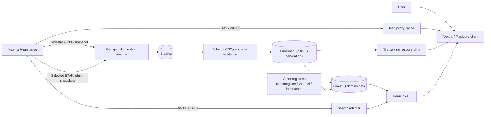

# ADR-001 — ForestIQ target geospatial architecture

**Status:** Proposed for implementation  
**Date:** 2026-09-06  
**Authority:** GitHub Epic #225 and Feature #226  
**Related:** #227, #228, #229, #230, #231, #232, #233, #234, #243

## 1. Decision context

ForestIQ needs a geospatial platform that can safely consume and serve nationwide Maa- ja Ruumiamet datasets while continuing to support CRM, ownership, Metsaregister and parcel workflows.

The current implementation is useful evidence, but it is **not a target-architecture constraint**. In particular, older documents and completed performance issues that prescribe a modular monolith, Spring-hosted MVT generation, EPSG:4326 canonical storage or WFS-based nationwide cadastre ingestion do not override Epic #225.

This ADR deliberately separates **stable responsibilities and contracts** from **replaceable implementation components**.

## 2. Decision

ForestIQ will use the following target responsibilities:

1. **Canonical spatial store** — PostgreSQL/PostGIS remains the authoritative store for published vector datasets and for spatial joins to ForestIQ domain identities.
2. **Geospatial ingestion runtime** — national snapshot ingestion runs outside latency-sensitive API request processing. The implementation may be a separate worker/process/container in the same repository; it does not have to be a Spring HTTP runtime.
3. **Snapshot-first national cadastre** — the official Maa- ja Ruumiamet nationwide downloadable cadastral snapshot (GeoPackage or an explicitly approved equivalent) becomes the primary national cadastre source. WFS is not the long-term full-country ingestion mechanism.
4. **Generation-safe publication** — cadastre, ETAK and administrative datasets are staged, validated and published as explicit source generations. Application reads never consume a partially loaded generation.
5. **Vector-tile map delivery** — nationwide vector geometry is delivered through bounded, zoom-aware vector tiles or an equivalent measured tile representation. It is never exposed as one national GeoJSON response.
6. **Tile implementation is intentionally undecided here** — #243 must benchmark credible alternatives before committing ForestIQ to Spring/PostGIS `ST_AsMVT`, a dedicated tile service, pre-generated tiles or a hybrid.
7. **Raster basemap boundary** — Maa- ja Ruumiamet TMS/WMTS basemaps are rendering inputs and are delivered through a controlled ForestIQ proxy/cache boundary. They are not copied into the canonical business database by default.
8. **Search boundary** — exact cadastral-code lookup is resolved from the locally published canonical parcel generation. Normal address/geocoding search is isolated behind a ForestIQ In-AKS/AKS adapter.
9. **Selective thematic ingestion** — only ETAK/administrative layers with an approved ForestIQ use case are mirrored locally. A full ETAK mirror is not a default goal.
10. **Domain API separation** — map tiles contain only data required to render/select. CRM, ownership, registry, evaluation and deal details remain domain API data loaded after selection.

## 3. Target responsibility map



The boxes above are **responsibilities, not mandatory microservices**. Multiple responsibilities may initially share a deployment where that is simpler, as long as their contracts remain separable.

## 4. Component decision matrix

| Responsibility | Selected direction | Alternatives considered | Why |
| --- | --- | --- | --- |
| Canonical vector storage | PostgreSQL/PostGIS | separate GIS DB engine; files/object store as primary | Existing domain joins and PostGIS spatial operations are a strong fit; replacing this store has no demonstrated benefit. |
| Cadastre/ETAK ingestion | Separate geospatial worker/process; prefer standard GIS/bulk tooling plus set-based PostgreSQL publication | execute all ingestion inside Spring API; row-by-row ORM/JDBC | National files are bulk ETL, not request/response work. Process isolation protects API latency and allows GDAL/OGR or equivalent tooling when useful. |
| Snapshot staging | PostGIS staging/generation structures; temporary/object storage for source files | overwrite `land_parcel` directly | Enables validation, atomic publication and rollback. |
| Domain API | Keep current Spring API initially | full API rewrite | Business workflows already exist; no GIS requirement justifies rewriting them now. Boundary remains replaceable later. |
| Web map client | Keep MapLibre and current web app initially | replace mapping/frontend framework | MapLibre supports raster/vector sources and zoom-aware styling; no current requirement needs a replacement. |
| Raster basemap | ForestIQ proxy/cache in front of MaRu TMS/WMTS | direct client calls; copy national raster set | Gives controlled provider usage, timeout/cache policy and attribution without duplicating business data. |
| Parcel tile service | **Decision deferred to #243** | Spring `ST_AsMVT`; dedicated tile service; pre-generated tiles; hybrid | Current implementation must not pre-decide the target. Select using production-shaped latency, cost, cacheability and security measurements. |
| Address search | Backend adapter to In-AKS/AKS | frontend direct provider dependency; build full local address registry immediately | Isolates provider contract and failures. Exact parcel lookup remains local. |
| Scheduler/run control | Durable source/run/generation model + DB-safe locking | one uncoordinated `@Scheduled` instance | Multiple replicas/workers must not publish competing generations. |
| Large raster/LiDAR | No production import in phase 1 | store all national DEM/LiDAR immediately | #254 must first prove user value, storage cost and processing architecture. |

## 5. Deployment options

The target contract permits all of the following without changing domain semantics:

### Initial low-complexity deployment

```text
frontend
api
geospatial-worker
postgres/postgis
map-proxy (may initially share a small runtime with api if isolated by resource limits)
```

The tile responsibility may initially share the API or become a dedicated component after #243.

### Later scaled deployment

```text
frontend
api replicas
geospatial worker(s)
scheduler/control-plane runtime
map proxy/cache
dedicated tile service or generated tile store (only if #243 selects it)
postgres/postgis
optional object storage for source artifacts
```

A microservice split is **allowed but not a goal**. A component is separated only when failure isolation, scaling, operational simplicity or cost justify it.

## 6. Data ownership boundaries

### National/public source data

Cadastre, ETAK and administrative source generations are provider-level/public datasets. They are not duplicated once per ForestIQ organization merely for storage.

### ForestIQ domain data

Owners, owner–parcel relationships, assignments, statuses, evaluations, deals, notes and other tenant-specific business data remain organization-scoped.

### Stable join boundary

Business data joins spatial source data through a stable ForestIQ parcel identity. A new source generation may change parcel attributes or geometry without recreating owner/CRM history.

## 7. Read-path contracts

### Map

```text
MapLibre
  -> basemap proxy for raster background
  -> vector-tile source for bounded parcel/thematic geometry
  -> domain API after a user selects a parcel
```

### Exact cadastral search

```text
cadastral code
  -> local published canonical parcel index
  -> stable parcel identity + bounds/centroid
  -> map focus at working/detail zoom
```

No provider request is required for an exact parcel already in the current published generation.

### Address search

```text
address text
  -> ForestIQ search API
  -> In-AKS/AKS adapter
  -> normalized bounded results
```

Provider failure must not make exact local parcel search or existing map/domain reads unavailable.

## 8. Write and publication contracts

Normal user-driven OLTP writes and national dataset ingestion are different workloads.

### OLTP

Use the normal domain service path for individual user actions, validation, authorization and audit.

### National ingestion

Use a bounded bulk pipeline:

```text
source artifact
 -> checksum + metadata
 -> staging generation
 -> schema and CRS validation
 -> geometry validation
 -> set-based reconciliation
 -> indexes/statistics/derived build readiness
 -> atomic publish
```

No row-oriented service loop is allowed to be the primary full-country ingestion path.

## 9. Security rules

- Public national source rows may be stored once globally.
- Tenant authorization is enforced before domain details or scoped tile representations are returned.
- Tile/cache keys must include every effective authorization/representation dimension if the selected tile architecture is scoped.
- Provider credentials or private configuration never ship in frontend bundles.
- Source/run telemetry must not use cadastral codes, owner IDs or other high-cardinality/private identifiers as metric labels.

## 10. Failure isolation

- A MaRu basemap outage must not make ForestIQ domain API readiness fail.
- An In-AKS outage must not break local cadastral-code lookup.
- A failed cadastre/ETAK import leaves the last-known-good generation current.
- A failed derived tile/read-model build blocks publication/cutover when that representation is required for a safe release.
- Worker resource exhaustion must not exhaust API request pools.

## 11. Compatibility and migration assets

Existing implementation is classified as follows:

| Existing asset | Target status |
| --- | --- |
| `CadastreDatasetSyncService` WFS national sync | migration/diagnostic asset; not target nationwide source |
| `external_dataset_*` snapshot concepts | useful design input; may be generalized/replaced by #251 |
| `land_parcel` domain identity and existing ownership links | preserve through migration; do not recreate business history |
| `land_parcel.boundary` EPSG:4326 | compatibility representation during migration; target canonical source geometry follows ADR-002 |
| `land_parcel_render` | candidate/disposable read model; #243 decides whether to retain/rebuild/replace |
| existing MVT endpoint/cache | candidate implementation; target semantics retained, implementation not guaranteed |
| MapLibre parcel selection/search UX | retain behavior; rebind to published source generation |
| per-parcel/full WFS refresh actions | migrate to generation-oriented source refresh semantics |

## 12. Superseded constraints

For GIS/Maa- ja Ruumiamet work this ADR supersedes narrower architecture constraints in older documents/issues where they conflict, including:

- `docs/architecture.md` requirement that canonical PostGIS geometry is necessarily EPSG:4326;
- `docs/backend-target-architecture.md` requirement that ForestIQ must remain a modular monolith for this work;
- completed #113/#132 non-goals that forbid architecture/service-boundary changes;
- #120 as a mandatory map read-model implementation;
- nationwide WFS as the canonical cadastre refresh mechanism.

The useful principles from those documents remain: explicit SQL for heavy spatial reads, bounded responses, vector tiles rather than national GeoJSON, tenant isolation, idempotent ingestion and measured performance.

## 13. Consequences

### Positive

- National imports are isolated from interactive traffic.
- Source publication and rollback become explicit.
- Map/render architecture can evolve independently from business APIs.
- Future component splits do not require changing parcel/domain semantics.
- ForestIQ can adopt MaRu datasets selectively without turning every WFS layer into an application dependency.

### Costs

- A separate ingestion runtime adds deployment/runbook work.
- Generation metadata and publication transitions require new schema/control-plane work.
- Migration temporarily needs compatibility views/projections and shadow validation.
- Tile architecture needs a benchmark before final implementation.

## 14. Implementation order

1. ADR-002: canonical CRS/geometry/generation contract (#235).
2. Cadastre WFS-to-snapshot migration plan (#236).
3. Generalized source/run/generation model (#251).
4. Snapshot downloader (#239) and generation-safe import (#240).
5. Stable parcel reconciliation (#241).
6. Tile decision benchmark (#243), implementation (#244) and MapLibre cutover (#245).
7. Final cadastre cutover/retirement of nationwide WFS (#242).
8. Selective ETAK/admin ingestion (#248–#250).

## 15. Decision guardrail

Future implementation PRs must preserve the contracts in this ADR, but may change programming language, framework, tile engine, process topology or hosting component when an ADR/benchmark demonstrates a better implementation. The current codebase is never sufficient justification by itself for retaining a component.